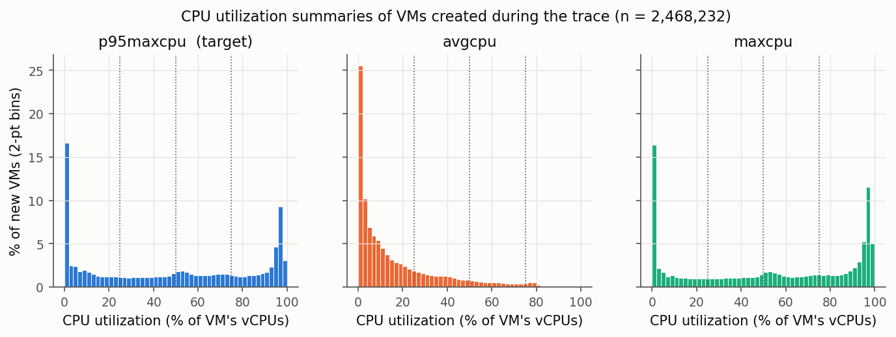
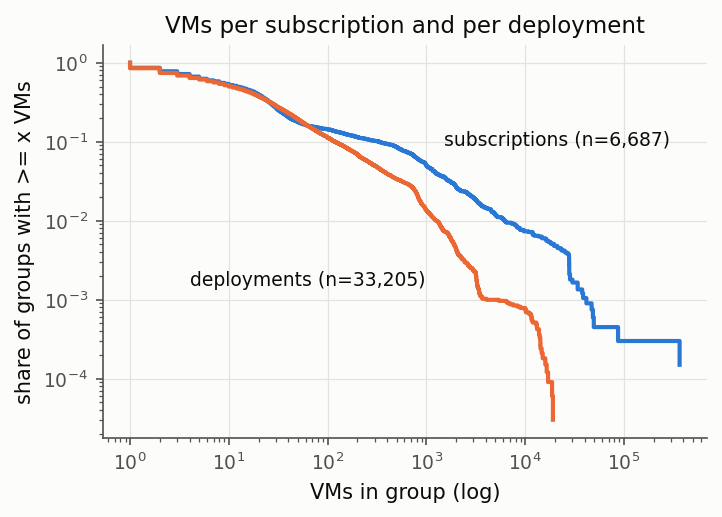
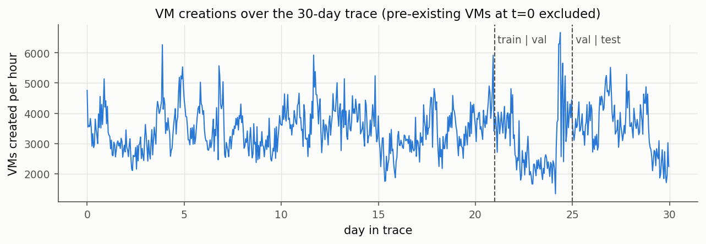
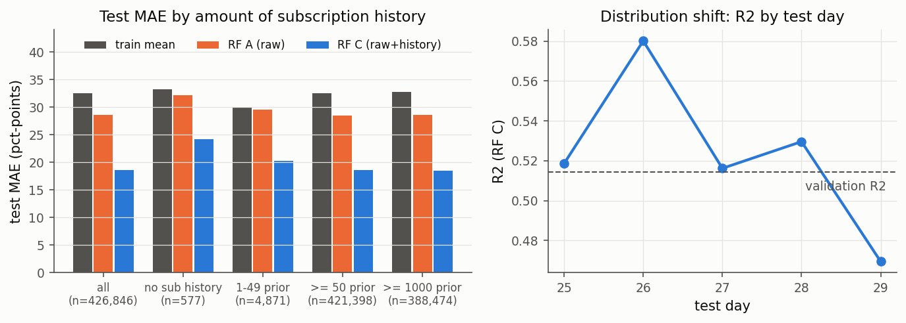
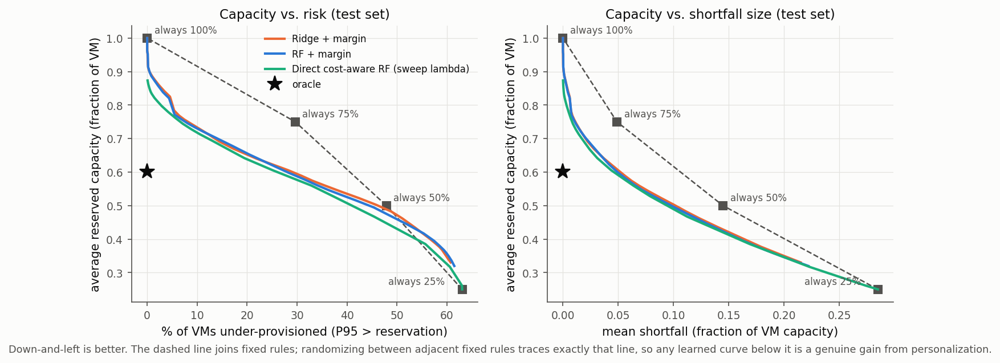
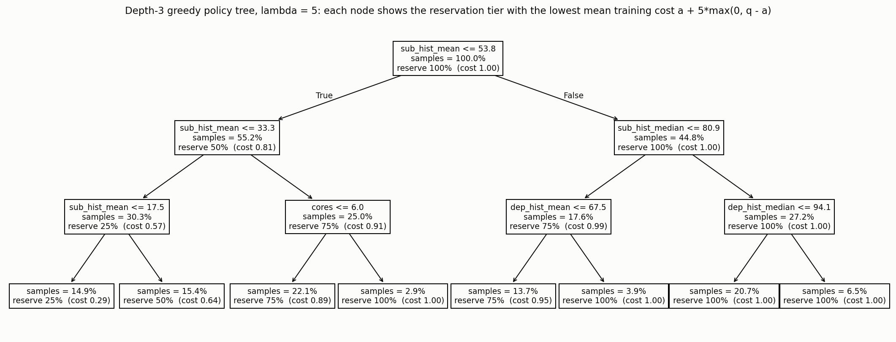
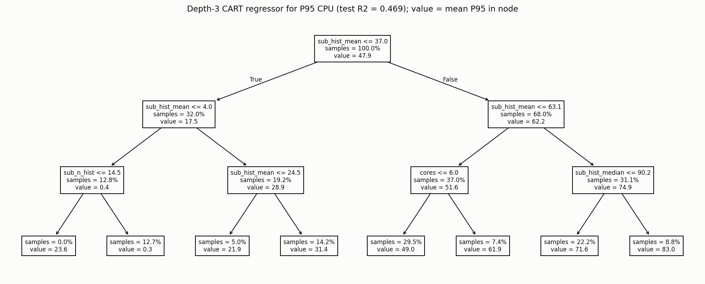
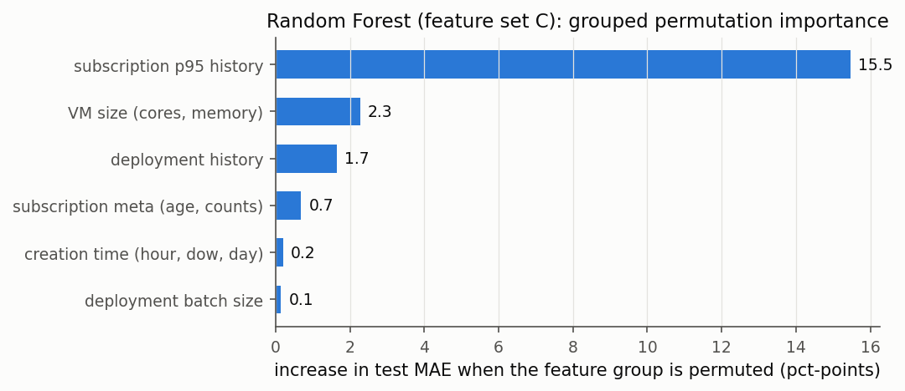

# Feasibility report: predictive and prescriptive right-sizing of Azure VMs

**Question.** Using only information available when a VM is created, is there enough signal to predict its P95 CPU
demand and make better individualized CPU reservations than a fixed rule?

## Recommendation: **GO, WITH CAVEATS**

* **Prediction works, and almost all the signal comes from customer history.** On the held-out last 5 days, a random
  forest reaches **R² = 0.53** (MAE 18.6 pts) vs. R² ≈ 0 for the mean baseline. Raw VM size and creation time alone
  reach only R² = 0.16. Adding *strictly past* subscription history lifts it to 0.51, and deployment history adds a little more.
* **A real right-sizing problem exists.** 35% of new VMs have P95 ≤ 25%, 15% fall in 25–50%, 19% in 50–75% and 31% above 75%.
  Demand is spread across every tier, so one size does not fit all.
* **Personalized reservations beat the best fixed rule by a clear margin.** With a shortfall penalty λ ∈ {2, 5, 10},
  a cost-aware random-forest policy cuts the expected cost by **13% / 21% / 17%** relative to the best fixed reservation
  (chosen on validation). A subscription-clustered bootstrap gives 95% CIs that exclude zero
  (e.g. λ = 5: savings 0.16–0.29 capacity units per VM). That closes 41–52% of the gap to a perfect-foresight oracle.
  The savings survive weighting by vCPUs (14–22%) and by vCPU-hours (14–18%).
* **A shallow policy tree already captures most of it.** A greedy depth-3 policy tree on four interpretable
  variables recovers 19.4% of the 21.5% saving at λ = 5. This supports an Optimal Policy Tree comparison, though OPT's
  headroom over greedy CART is likely modest.

**The caveats that should shape the final framing:**

1. **This is "history-informed right-sizing for returning customers", not cold-start prediction.** 99.9% of test VMs
   come from subscriptions with completed history. Only 577 test VMs (213 subscriptions) have none, and for those the
   models are no better than the mean (R² < 0). Cold start is too rare in this trace to study seriously.
2. **The "P95" target is degenerate for short-lived VMs.** 68% of VMs live under 1 hour and 20% live ≤ 5 minutes. For
   75% of VMs `p95maxcpu == maxcpu`, so the target is really "peak CPU over a short life". Prediction is poor for
   ≤ 5-minute VMs (R² −0.9) and for VMs living more than a day (R² 0.16). The vCPU-hour-weighted policy result still
   holds, but the final project should report weighted costs or restrict the population, and say so explicitly.
3. **Naive "predict, then bucket" is not enough.** Rounding the predicted P95 up to the next tier is *worse* than
   always reserving 100% at λ = 10 (cost 1.09–1.10 vs. 1.00). Decisions must be cost-aware: a validation-tuned safety
   margin, a predicted-shortfall model, or a policy tree. That is a good methodological story for the project.
4. **λ ≤ 1 is degenerate** (always 25% is optimal), so the final project needs a defensible λ range, roughly 2–10.

---

## 1. Data (Step 1)

Only the official per-VM summary table and two small companion tables were downloaded. The 5-minute telemetry
(156 GB compressed) was not needed.

| file | compressed | uncompressed | rows | columns |
|---|---:|---:|---:|---:|
| `trace_data_vmtable_vmtable.csv.gz` | 437.6 MB | 821.2 MB | 2,695,548 | 11 |
| `trace_data_deployments_deployments.csv.gz` | 2.0 MB | 3.1 MB | 33,205 | 2 |
| `trace_data_subscriptions_subscriptions.csv.gz` | 0.35 MB | 0.5 MB | 6,687 | 3 |

The verified VM-table schema (no header, column order from `schema.csv`) is `vmid, subscriptionid, deploymentid,
vmcreated, vmdeleted, maxcpu, avgcpu, p95maxcpu, vmcategory, vmcorecountbucket, vmmemorybucket`. The deployment table is
`deploymentid, deploymentsize`. The subscription table is `subscriptionid, first_vm_ts, count_vms`.

| statistic | value |
|---|---:|
| time coverage | 30 days: t = 0 … 2,591,400 s on a 300 s grid (relative time only; no calendar dates are published) |
| unique subscriptions / deployments | 6,687 / 33,205 |
| VMs already running at t = 0 (left-censored, history only) | 227,316 (8.4%) |
| VMs still running at trace end (right-censored) | 224,509 (8.3%) |
| **VMs created during the trace (modelling population)** | **2,468,232** in 3,499 subscriptions, 28,208 deployments |

Full tables: `results/01_files.md`, `results/01_dataset_stats.md`.

## 2. Data quality and profile (Step 2)

There are **no missing values** in any column (`results/01_column_profile.md`). Answers to the five questions:

1. **Is `p95maxcpu` populated?** Yes: 0% missing and essentially continuous (2.47 M distinct values). No value
   exceeds 100. It is not lumped onto a few discrete values, but it is **bimodal** (fig 1): 14% of VMs sit below 1% and a
   second peak sits at 95–99%.
2. **Is there substantial variation?** Yes: mean 48.1, SD 36.2, IQR 9.7–84.6.
3. **Are many VMs underutilized?** Yes: 35% have P95 ≤ 25%, and median average CPU is only 8.5%.
4. **Are there repeated VMs per subscription?** Yes, overwhelmingly. The median subscription has 12 VMs, but volume is
   concentrated: the top subscription has 15% of new VMs, the top 100 have 77%, and 99.3% of new VMs belong to
   subscriptions with ≥ 50 VMs (fig 2).
5. **Are the size buckets informative?** Coarse but informative. Cores (5 buckets) and memory (6 buckets) are
   nearly collinear (only ~9 combinations occur; `results/01_core_memory_crosstab.md`). By themselves they explain little
   (size-group-mean baseline R² = 0.09), but the differences are real: median P95 is 57% for 2-core VMs vs. 20% for
   4-core VMs.

## 3. Leakage classification (Step 3)

| class | variables | why |
|---|---|---|
| **Safe creation-time** | `vmcorecountbucket`, `vmmemorybucket`, `vmcreated` → hour, relative day-of-week, day-in-trace; `dep_batch_size` = VMs of the same deployment requested in the same 5-minute slot | Known when the request arrives. `dep_batch_size` assumes a multi-VM request's size is known; dropping it costs only ΔR² = −0.005. |
| **Derived historical (strictly past)** | subscription and deployment history features (§4) | Built only from VMs **deleted before** the current VM was created |
| **Grouping keys only** | `subscriptionid`, `deploymentid` | Used to look up history; never used as numeric or categorical predictors |
| **Post-deployment / leakage — excluded** | `p95maxcpu` (target), `avgcpu`, `maxcpu`, `vmdeleted`, lifetime | Observed only after the VM runs |
| | **`vmcategory`** | Leakage. Every Interactive / Delay-insensitive VM lived ≥ 120 h, and every VM living < 72 h is "Unknown" (`results/01_vmcategory_vs_lifetime.md`). The label is assigned from days of observed utilization, so it encodes both lifetime and the CPU pattern. |
| | **`deploymentsize`** (deployment table) | A whole-trace aggregate that includes future VMs. It equals the in-table VM count only 50% of the time (`results/01_deploymentsize_check.md`). Replaced by creation-time deployment features. |
| | subscription table `count_vms` | Whole-trace count. `first_vm_ts` is safe but redundant with the VM table. |

**A subtle leak avoided.** A prior VM's `p95maxcpu` summarizes its *entire* lifetime, so it is unknown while that VM is still
running. Using every VM *created* before time t (the obvious approach) peeks into the future. Measured effect: R² 0.538
with this lenient history vs. 0.508 with strict history, for the same model. All reported models use the strict version.
As a cautionary benchmark, adding lifetime + `vmcategory` would inflate R² to 0.64.

## 4. Features and split (Steps 4–5)

There are 26 compact features in three nested sets (definitions in `src/02_features.py`; vectorized implementation
verified against a brute-force recomputation on 350 random rows):

* **A, raw (7 features):** cores, memory, memory per core, hour, relative day-of-week, day-in-trace, deployment batch size.
* **B = A + subscription history (13 features):**
  * subscription age and whether it existed at trace start;
  * number of earlier VMs created, and number of earlier VMs *completed* (deleted);
  * over completed VMs: mean, median, SD, most recent, and last-5 mean of P95, plus the shares with P95 ≤ 25 / 50 / 75%;
  * a cold-start flag.
* **C = B + deployment history (6 features):** earlier VMs created, earlier completed VMs, and the mean / median / most
  recent P95 of those completed VMs, plus a cold-start flag.

**Imputation (training rows only).** When a subscription has no completed history, its statistics are filled with
training-set target statistics. Deployment statistics fall back to the subscription's (still strictly past) values.
The `*_cold` flags record that a value was imputed.

**Chronological split** (by `vmcreated`; `results/02_split_and_history_coverage.md`):

| split | days | VMs | share | subscriptions | share with completed sub history |
|---|---|---:|---:|---:|---:|
| train | 0 – 20 | 1,747,514 | 70.8% | 3,015 | 99.2% |
| validation | 21 – 24 | 293,872 | 11.9% | 1,462 | 99.8% |
| test | 25 – 29 | 426,846 | 17.3% | 1,726 | 99.9% |

All models are fit on train, tuned on validation, and reported on test. The feature table is saved as
`data/processed/features.parquet` (150 MB).

## 5. Predictive results (Steps 6–7)

Test set (days 25–29); full table with validation metrics in `results/03_model_results.md`:

| model | features | MAE | RMSE | R² |
|---|---|---:|---:|---:|
| train mean | – | 32.48 | 36.30 | 0.00 |
| train median | – | 32.52 | 36.41 | −0.01 |
| size-group (cores × memory) mean | – | 30.53 | 34.65 | 0.09 |
| subscription's historical mean P95 (no model) | – | 19.69 | 26.14 | 0.48 |
| Ridge | A / B / C | 30.10 / 19.64 / 19.48 | 34.26 / 25.97 / 25.77 | 0.11 / 0.49 / 0.49 |
| CART (128 leaves, chosen on val) | A / B / C | 28.09 / 19.58 / 18.64 | 33.24 / 26.55 / 25.40 | 0.16 / 0.46 / 0.51 |
| **Random Forest** | A / B / C | 28.54 / 18.95 / **18.58** | 33.17 / 25.44 / **24.83** | 0.16 / 0.51 / **0.53** |

**Ablation answer: yes, historical customer behaviour materially improves prediction.** Adding subscription history
cuts RF MAE from 28.5 to 19.0 (−34%) and raises R² from 0.16 to 0.51. Deployment history adds a small further gain (R² 0.53).

**By amount of history** (RF, test; `results/03_segments_by_history.md`):

| segment | VMs | subs | R² RF-A | R² RF-C | MAE RF-C |
|---|---:|---:|---:|---:|---:|
| no completed subscription history | 577 | 213 | −0.75 | −0.11 | 24.1 |
| ≥ 1 prior completed VM | 426,269 | 1,574 | 0.16 | 0.53 | 18.6 |
| ≥ 5 | 425,539 | 1,323 | 0.16 | 0.53 | 18.6 |
| 1 – 49 (thin history) | 4,871 | 855 | −0.07 | 0.40 | 20.3 |
| ≥ 50 | 421,398 | 766 | 0.17 | 0.53 | 18.6 |
| ≥ 1,000 | 388,474 | 263 | 0.18 | 0.54 | 18.5 |

## 6. Is there a right-sizing problem? (Step 8)

Share of VMs whose actual P95 needs each tier (`results/04_tier_shares_pct.md`):

| tier needed | train | val | test | all |
|---|---:|---:|---:|---:|
| P95 ≤ 25% | 35.4% | 31.3% | 36.9% | 35.2% |
| 25% < P95 ≤ 50% | 14.9% | 14.4% | 15.2% | 14.9% |
| 50% < P95 ≤ 75% | 18.8% | 20.0% | 18.3% | 18.9% |
| P95 > 75% | 30.9% | 34.2% | 29.6% | 31.1% |

No single category dominates, so the decision problem is non-trivial.

## 7. Capacity vs. under-provisioning (Step 9)

**Units.** q = P95/100 is demand as a fraction of the VM's *own* allocated vCPUs. A reservation a ∈ {0.25, 0.5, 0.75, 1}
is the fraction of those vCPUs held back. Shortfall = max(0, q − a); waste = max(0, a − q). Test set
(`results/04_policy_tradeoff_table.md`):

| policy | avg reserved | % VMs under-provisioned | mean shortfall | mean waste | tier mix 25/50/75/100 (%) |
|---|---:|---:|---:|---:|---|
| always 25% | 0.250 | 63.1 | 0.285 | 0.071 | 100 / 0 / 0 / 0 |
| always 50% | 0.500 | 47.9 | 0.145 | 0.181 | 0 / 100 / 0 / 0 |
| always 75% | 0.750 | 29.6 | 0.049 | 0.335 | 0 / 0 / 100 / 0 |
| always 100% | 1.000 | 0.0 | 0.000 | 0.536 | 0 / 0 / 0 / 100 |
| threshold routing, Ridge | 0.606 | 28.2 | 0.050 | 0.191 | 18 / 34 / 36 / 12 |
| threshold routing, CART | 0.605 | 24.7 | 0.048 | 0.189 | 20 / 39 / 21 / 20 |
| threshold routing, RF | 0.598 | 28.4 | 0.050 | 0.184 | 19 / 34 / 36 / 11 |
| oracle (smallest sufficient tier) | 0.602 | 0.0 | 0.000 | 0.137 | 37 / 15 / 18 / 30 |

"Best fixed in hindsight" needs a criterion for trading capacity against risk, so it is reported per λ in §8. It is 25%, 50%, 100% and 100% for λ = 1, 2, 5 and 10, and each of those rows appears in this table.

Compare RF routing with "always 75%": both under-provision ~29% of VMs with the same mean shortfall (0.05), but RF
routing reserves **20% less capacity** (0.60 vs. 0.75). Sweeping a safety margin traces a whole frontier that lies
well inside the fixed-rule frontier (fig 7). The dashed line is what randomizing between fixed rules achieves, so every
learned curve below it is a gain that comes purely from personalization.

## 8. Cost comparison across shortfall penalties (Step 10)

**Cost per VM.** Cost_i(a) = a + λ·max(0, q_i − a), in units of "one VM's allocated capacity": always-100% costs 1.0,
and λ is the price of one unit of unmet P95 demand relative to one unit of reserved capacity.

**What is tuned on validation.** The best fixed tier; the safety margin δ for the "+ margin" policies (reserve the
smallest tier ≥ prediction + δ); and the CART size. **"Direct cost-aware" models** predict the expected shortfall at
each tier (multi-output RF/CART) and pick the tier minimizing a + λ·predicted shortfall. **The oracle** picks each VM's
cost-minimizing tier in hindsight.

Mean test cost (lower is better; `results/04_policy_costs_by_lambda.md`):

| policy | λ = 1 | λ = 2 | λ = 5 | λ = 10 |
|---|---:|---:|---:|---:|
| best fixed (chosen on val) | 0.535 (25%) | 0.790 (50%) | 1.000 (100%) | 1.000 (100%) |
| Ridge, naive threshold | 0.656 | 0.705 | 0.855 | 1.104 |
| Ridge + val-tuned margin | 0.537 | 0.697 | 0.803 | 0.856 |
| CART + val-tuned margin | 0.540 | 0.691 | 0.805 | 0.861 |
| RF, naive threshold | 0.648 | 0.698 | 0.848 | 1.099 |
| RF + val-tuned margin | 0.536 | 0.690 | 0.804 | 0.848 |
| direct cost-aware CART | 0.535 | 0.694 | 0.812 | 0.855 |
| **direct cost-aware RF** | 0.535 | **0.687** | **0.785** | **0.834** |
| depth-3 policy tree | 0.535 | 0.698 | 0.806 | 0.867 |
| oracle (hindsight cost-optimal) | 0.535 | 0.571 | 0.589 | 0.595 |
| *direct RF saving vs best fixed* | *0%* | *13.0%* | *21.5%* | *16.6%* |
| *share of fixed→oracle gap closed* | – | *47%* | *52%* | *41%* |

* **Uncertainty.** A bootstrap over subscriptions (500 reps) gives 95% CIs for the direct RF's saving of
  0.08–0.12 (λ = 2), 0.16–0.29 (λ = 5) and 0.10–0.24 (λ = 10) capacity units per VM
  (`results/04_bootstrap_direct_rf_vs_best_fixed.md`).
* **Weighting.** Savings are 14 / 22 / 18% weighted by vCPUs and 14 / 18 / 15% weighted by vCPU-hours (lifetime used only
  as an evaluation weight; `results/04_weighted_costs.md`).
* **What the λ = 5 policy does.** The direct RF reserves 0.725 of capacity on average (vs. 1.0), under-provisions
  9.2% of VMs, and has a mean shortfall of 1.2% of VM capacity (`results/04_lambda5_policy_details.md`).

## 9. Would an Optimal Policy Tree have something to learn? (Step 11)

1. **Is there heterogeneity?** Yes. The oracle uses all four tiers in substantial proportions (37 / 15 / 18 / 30%), and
   learned policies also use all four (e.g. direct RF at λ = 5: 16 / 14 / 33 / 37%).
2. **Does CART learn non-trivial splits?** Yes. The depth-3 greedy policy tree at λ = 5 (fig 8) splits on subscription
   mean P95 (53.8, then 33.3 / 17.5), subscription median P95, cores ≤ 6, and deployment mean / median P95. Its eight
   leaves assign 25%, 50%, 75% and 100% (`results/04_policy_tree_lambda5_leaves.md`), so it does not collapse to one action.
3. **Are useful variables interpretable?** Yes: historical subscription CPU level, requested core count, and deployment
   CPU history. No IDs are used.
4. **Is there enough improvement to justify OPT?** Yes. The depth-3 tree already saves 19.4% at λ = 5 and closes 47% of
   the fixed-to-oracle gap. The full RF policy reaches 52%, which leaves room for an OPT to compete. A realistic
   expectation is that OPT beats greedy depth-3 CART by a modest margin, not by a large one.

## 10. Feature importance (Step 12)

Grouped permutation importance (increase in test MAE when a block of features is shuffled; RF / CART on set C;
`results/03_grouped_importance.md`, per-feature in `results/03_feature_importance.md`):

| feature group | RF ΔMAE | CART ΔMAE |
|---|---:|---:|
| subscription P95 history | 15.5 | 17.4 |
| VM size (cores, memory) | 2.3 | 2.2 |
| deployment history | 1.7 | 0.8 |
| subscription meta (age, counts) | 0.7 | 0.9 |
| creation time | 0.2 | 0.2 |
| deployment batch size | 0.1 | 0.1 |

The model works through interpretable aggregates, not ID memorization: IDs are never features, and the strongest single
predictors are `sub_hist_mean`, `sub_hist_median`, `sub_hist_frac_le50` and `cores`. Creation time is nearly useless.

## 11. Stress tests (Step 13)

`results/03_stress_tests.md`; RF on feature set C unless noted.

| check | result |
|---|---|
| **Cold start** | Only 577 test VMs (0.14%) lack completed subscription history. For them R² = −0.11 (MAE 24.1, vs. 33.2 for the mean baseline). Brand-new subscriptions: 236 VMs, R² −0.06. Too few to study, and weakly predictable. |
| **Sample size after requiring history** | Requiring ≥ 5 completed prior VMs keeps 99.7% of test VMs; ≥ 50 keeps 98.7%. History requirements cost almost nothing. |
| **Missing data** | None in raw columns. History-statistic gaps are confined to the cold rows above and are imputed from training data. |
| **Short / long-lived VMs** (post-hoc slices, never features) | Lifetime ≤ 5 min: R² −0.91 (P95 from ~1 reading). 5 min – 1 h: 0.55. 1 h – 1 day: 0.41. > 1 day: 0.16. 75% of VMs have P95 = max. |
| **Distribution shift** | Validation R² 0.51; test days 0.52 / 0.58 / 0.52 / 0.53 / 0.47. Day 29 is the weakest: it is a partial day and 15% of its VMs are right-censored at trace end. No systematic drift. |
| **Label availability** | Training only on VMs whose label was known by the training cutoff (deleted before day 21) changes test R² from 0.531 to 0.526. |
| **Concentration** | Excluding the 10 largest training subscriptions, test R² = 0.57. Subscription-macro-averaged MAE is 21.3 vs. 30.6 for the baseline. Results are not driven by a few giant customers. |
| **Target distribution** | Bimodal, with 14% below 1% and a peak at 95–99%. Not concentrated on a few values: the 10 most common values cover < 0.01%. |
| **Leakage** | Every feature is computed from VMs created (counts) or deleted (P95 statistics) strictly before the current VM. Sensitivity runs: lenient history R² 0.538 vs. strict 0.508; adding forbidden lifetime + `vmcategory` gives 0.639; dropping `dep_batch_size` gives 0.526. |

## 12. Suggested framing for the final project

* **Population.** VMs from subscriptions with prior completed VMs (≈ 99.9% of volume). Report cold-start separately
  as a limitation.
* **Target.** Keep `p95maxcpu`, but evaluate costs both per VM and **vCPU-hour-weighted**, or restrict to VMs with
  enough readings (e.g. lifetime ≥ 1 h, applied only as a population filter with the selection effect acknowledged).
* **Methods.** (i) Predict-then-route with a validation-tuned margin; (ii) direct cost-aware RF / CART; (iii) Optimal
  Policy Tree on the cost matrix, at depths 2–4 with λ ∈ {2, 5, 10}, compared against the greedy depth-3 tree here. The
  policy-tree input is just the n × 4 cost matrix, which `src/04_policies.py` already builds.
* **Feature set.** The 26 features of set C are sufficient. More feature engineering is unlikely to change the conclusion.
